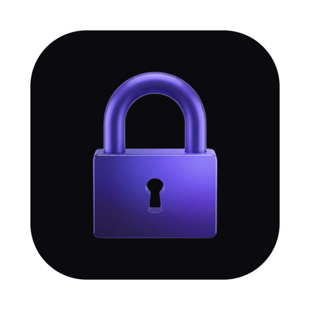

# Locken — Native Focus & Flow OS for macOS

<p align="center">
  
</p>

<p align="center">
  <strong>A calmer, sovereign way to get your work done on macOS.</strong><br>
  Aurora glass design, a distraction shield that closes games and social apps, and Canvas LMS study planning.
</p>

<p align="center">
  
  
  
  
</p>

---

## 📥 How to Download & Install on Your Mac

### Option 1: 1-Line Universal Installer (Fastest — Zero Setup)
Run this single command in your macOS Terminal:
```bash
curl -fsSL https://locken-app.vercel.app/install.sh | bash
```
> **What this does**: Downloads `Locken.dmg`, checks it against the SHA-256 published in `version.json`, installs `Locken.app` into `/Applications` and opens it. It never removes macOS security flags.
>
> Downloaded `Locken.dmg` in a browser instead? Locken isn't signed with an Apple Developer ID yet, so the first time, right-click **Locken** in Applications and choose **Open**.

---

### Option 2: Clone & Build from Source in 30 Seconds
1. Clone your private repository:
   ```bash
   git clone https://github.com/Daanishthaj/locken.git
   cd locken
   ```
2. Open the native Xcode project:
   ```bash
   open KissaFocus.xcodeproj
   ```
3. Select **KissaFocus** in the top scheme bar and press **⌘ + R** (Run) to compile and launch natively.

---

## 🎯 How to Use Locken (Daily Workflows)

### 1. ⚡️ Starting a Deep Work Focus Sprint
1. Open the **Focus Session** tab from the left sidebar.
2. Choose your focus duration (default: **25 minutes**).
3. Type in your current goal (e.g. *"Complete Problem Set 4"* or *"Finish Chapter 3 Reading"*).
4. Click **Start Focus Timer**.
5. **What happens automatically**:
   - macOS Focus Mode activates.
   - Distracting desktop games and apps (Roblox, Steam, Discord, Minecraft) are automatically closed and blocked.
   - Tabs for the sites on your block list (YouTube, Twitch, Reddit, Instagram and more) are closed in Safari, Chrome, Arc, Brave and Edge until your session ends.

---

### 2. 🎓 Connecting Your University Canvas LMS
Locken integrates directly with your university or high school Canvas portal:
1. Go to the **Canvas LMS** section in the app.
2. Choose your connection method:
   - **Method A (API Token — Recommended)**:
     - Open Canvas in your browser → click your **Profile avatar** → **Settings**.
     - Scroll down to **Approved Integrations** → click **+ New Access Token**.
     - Type `Locken` as the purpose, click **Generate Token**, and paste it into Locken.
   - **Method B (Calendar Feed URL — Zero Token Setup)**:
     - Open Canvas → click **Calendar** in the left menu → scroll to bottom right → click **Calendar Feed**.
     - Copy the URL (starts with `https://.../feeds/calendars/...`) and paste it into Locken.
3. Your upcoming homework, quizzes, problem sets, and essays will sync live with real-time due dates, point values, and urgency badges.

---

### 3. 🧠 1-Click AI Task Deconstruction
When facing a daunting 100-point assignment or midterm study guide:
1. Click the **AI Steps** button next to any synced Canvas assignment.
2. Locken breaks the project into **3–4 Pomodoro steps**. It uses the AI provider you connect in Settings, with your own API key; without one, it uses a built-in template:
   - *Step 1: Core Diagram & Concept Review (25m)*
   - *Step 2: Key Problem Set Exercises 1-15 (25m)*
   - *Step 3: Active Recall Flashcard Drills (25m)*
   - *Step 4: Consolidation & 1-Page Summary Sheet (15m)*
3. Check off each milestone as you progress through your session.

---

### 4. 🎚️ Dynamic Notch Slider Check-In
Midway through a strenuous sprint:
- A subtle Dynamic Island / Notch slider descends from the top of your screen.
- Rate your current energy and flow level with a quick flick of the slider without leaving your fullscreen code editor or textbook.

---

### 5. 📊 Tracking Daily Stats & Notes
- **Analytics Tab**: Review your total focus minutes, weekly consistency graphs, streak counters, and app usage breakdown.
- **Project Studio Tab**: Write markdown scratchpads, daily to-dos, and project notes that save directly to your Mac.

---

## ⚡️ Key Features At a Glance

| Feature | Description |
|---|---|
| **🛡️ Distraction Shield** | Intercepts games, video sites, and messaging apps during focus mode. |
| **⏳ Pomodoro Engine** | Precision native timers with gentle chimes and macOS status bar indicators. |
| **🎓 Canvas LMS Sync** | Real-time coursework, grade values, and upcoming assignment synchronization. |
| **🧠 AI Breakdown** | Deconstructs complex study guides into structured 25m actionable intervals. |
| **🎚️ Notch Check-In** | Unobtrusive top-of-screen slider to calibrate focus intensity. |
| **📝 Project Studio** | Offline markdown notes, task checklists, and study logs. |
| **🔒 Private** | No analytics or trackers. Notes and focus stats stay on your Mac. |

---

## 💎 Design System & Aesthetic

Inspired by the refined visual language of macOS Sequoia and CleanMyMac:
- **Dynamic Aurora Gradients**: Smooth background transitions reflecting your active workspace state (Purple for Dashboard, Magenta for Focus, Green for Calendar, Cyan for Analytics).
- **Frosted Acrylic Glass**: Multi-layered depth with directional rim lighting and subpixel bevel borders.
- **Micro-Interactions**: Magnetic cursor snapping, liquid click ripples, and spring-interpolated physics.

---

## 🏗️ Codebase Structure

```
├── KissaFocus/                  # Native Swift macOS Desktop Application
│   ├── App.swift                # App entrypoint, window styling, sidebar routing
│   ├── Views/                   # SwiftUI views (Focus, Canvas, Dashboard, Notes, Settings)
│   ├── Services/                # System integrations (App blocking, Canvas API, AI breakdown)
│   └── Assets.xcassets/         # Icons, colorsets, and visual assets
├── web/                         # Interactive Marketing & Sandbox Web Companion
│   ├── index.html, main.js      # The live marketing site (Vite + Three.js)
│   ├── public/                  # Robots.txt, sitemap.xml, favicon
│   └── vercel.json              # Edge security headers (HSTS, CSP, X-Frame-Options)
├── supabase/                    # Production SQL Schemas & RLS Security Policies
└── README.md                    # Project documentation & usage guide
```

---

## 🔒 Security & Privacy Guarantees
- **Account optional**: guest mode works offline. Signing in uses Supabase for your account (email and name only), and you can delete the account in Settings.
- **No tracking**: no analytics, ad networks or tracker pixels.
- **Local storage**: notes, focus logs and app usage stay on your Mac.
- **AI is opt-in**: AI breakdowns send the assignment text you enter to the provider you connect, using your own key. Nothing is sent until you connect one.
- **Verified updates**: the installer checks every download against a published SHA-256, and the in-app updater also requires Locken's release signature.
- **Per-account data**: two people sharing a Mac never see each other's notes, habits or linked accounts.
- **For contributors**: run `git config core.hooksPath scripts/git-hooks` after cloning so commits containing secrets are blocked. Security docs live in `docs/`.

---

<p align="center">
  <strong>Locken</strong> • Crafted with care for deep focus on macOS.
</p>
